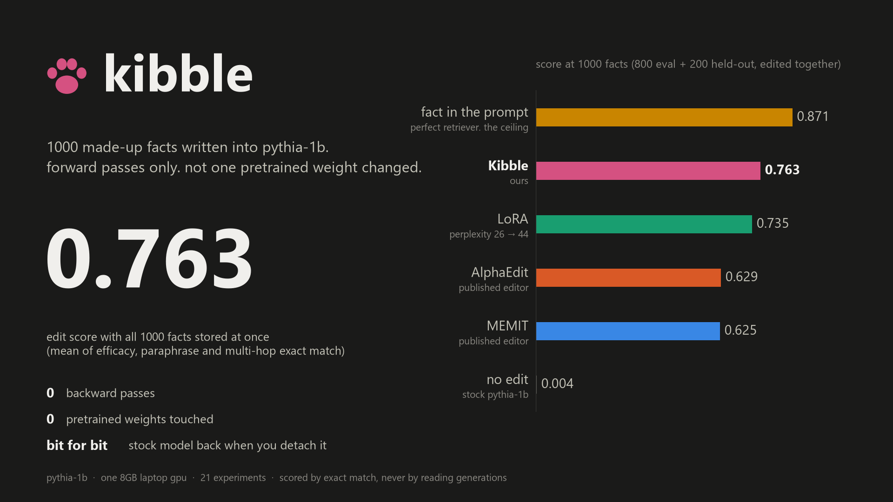
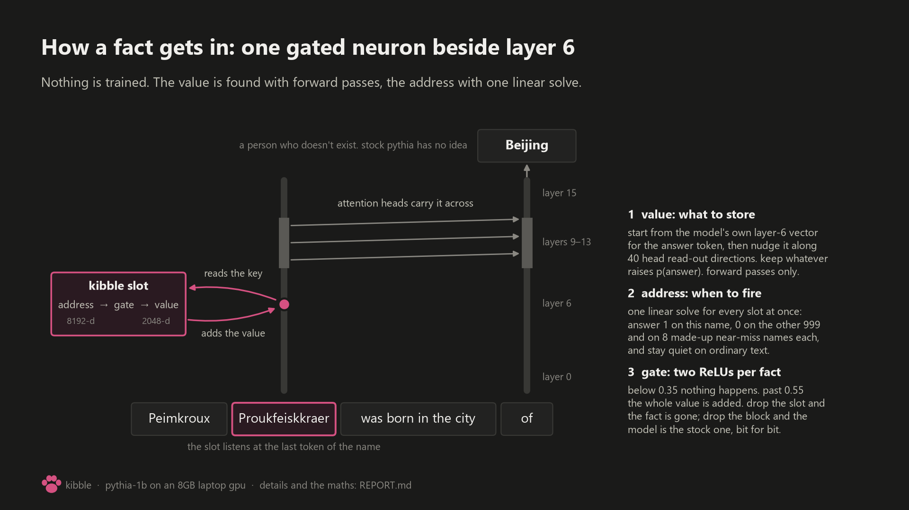
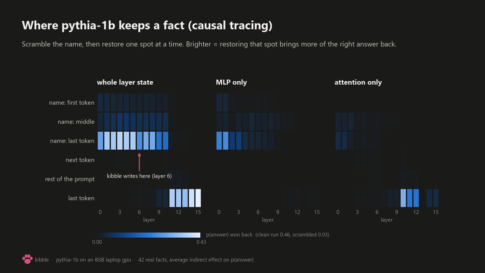
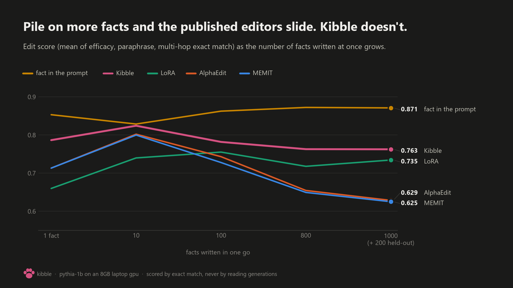
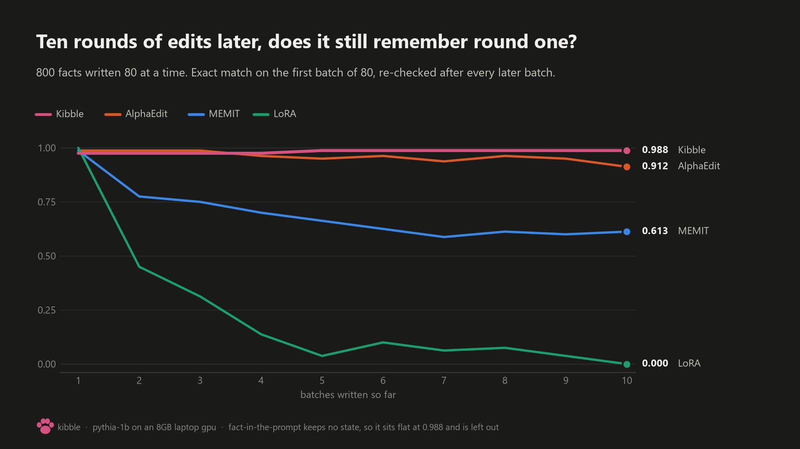
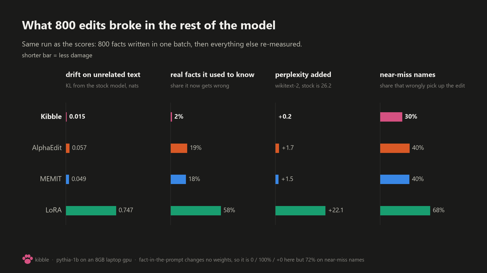
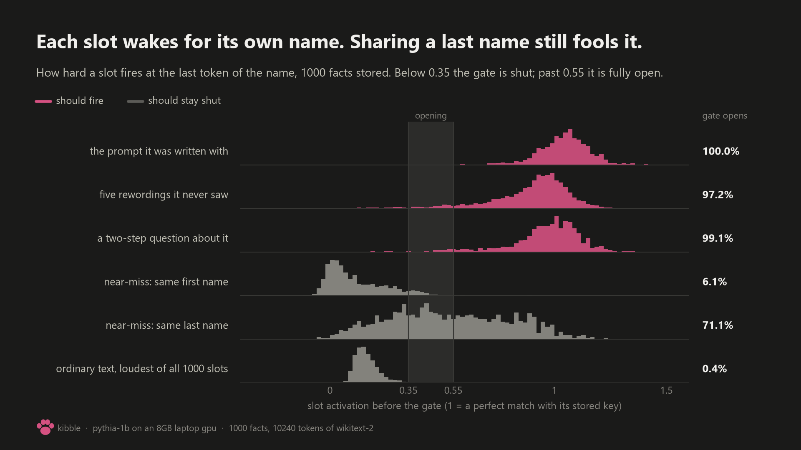
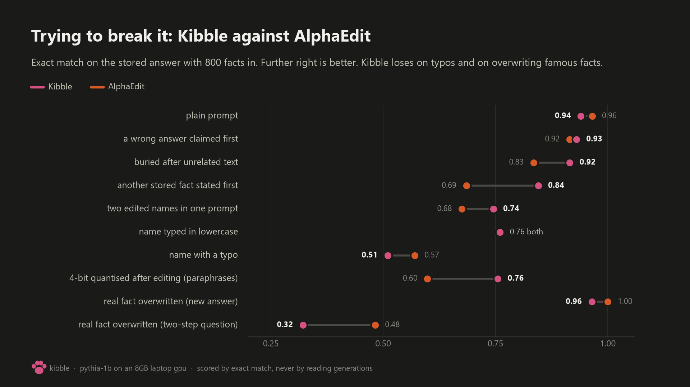
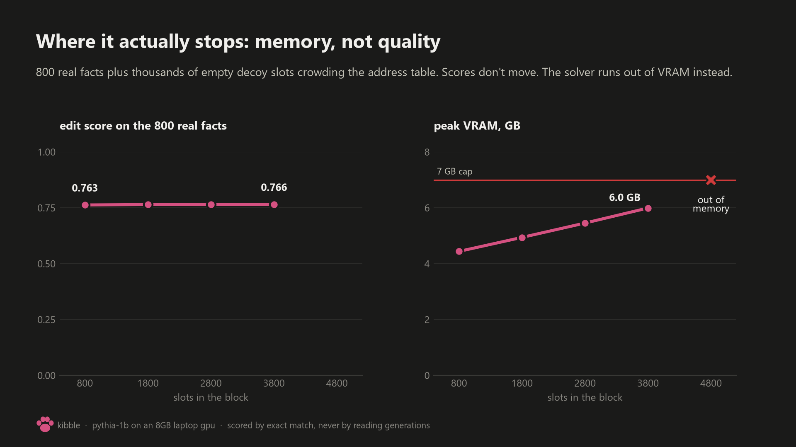

# kibble

a way to write facts straight into a small LLM without training it.

each fact becomes one gated neuron parked beside layer 6 of [pythia-1b](https://huggingface.co/EleutherAI/pythia-1b).
finding what to store takes forward passes only, finding when to fire takes one linear solve, and no
pretrained weight is ever changed. pull the pack off and you have stock pythia again, bit for bit.

in this repo: a pack with 1000 facts about people, companies, towns, tablets and minerals that don't exist,
a tiny loader, the figures, the whole lab notebook, and all the code and result json to rerun it on an 8GB card.

lives in two places: [hugging face](https://huggingface.co/skyuu72/kibble-pythia-1b) and [github](https://github.com/Metrix187/kibble-pythia-1b). same files.

## does it work

1000 facts written at once (800 eval + 200 held-out). score = mean of efficacy, paraphrase and multi-hop
exact match. nothing is scored by reading generations.

| | efficacy | paraphrase | multi-hop | **score** | drift on other text (KL) | real facts kept | perplexity |
|---|---|---|---|---|---|---|---|
| stock pythia-1b | 0.004 | 0.002 | 0.005 | 0.004 | 0 | 1.000 | 26.17 |
| MEMIT | 0.945 | 0.631 | 0.300 | 0.625 | 0.064 | 0.800 | 28.09 |
| AlphaEdit | 0.949 | 0.641 | 0.296 | 0.629 | 0.077 | 0.744 | 28.41 |
| LoRA (r=8) | 1.000 | 0.924 | 0.280 | 0.735 | 0.600 | 0.306 | 44.40 |
| **kibble** | 0.958 | 0.808 | 0.522 | **0.763** | 0.004 | 0.983 | 26.19 |
| fact pasted into the prompt, perfect retriever | 0.997 | 0.766 | 0.851 | 0.871 | 0 | 1.000 | 26.17 |

so it beats both published editors, and it does **not** beat putting the fact in the context window when
something hands you exactly the right fact. that last row is the ceiling and nothing written into weights
got near its multi-hop.

read this before quoting any of it:

- MEMIT, AlphaEdit and LoRA here are reimplementations from the papers, tuned on a separate 200-fact
  tune split. not the authors' code.
- one model, seven templated relations, made-up subjects. the held-out facts are new names on the same templates.
- "into the weights" is generous. kibble adds neurons, it doesn't rewrite existing ones.

## try it

```bash
pip install torch transformers safetensors huggingface_hub
hf download skyuu72/kibble-pythia-1b kibble.py --local-dir .
python kibble.py
```

```
1000 facts attached at layer 6

Kryskorn Skeithhaes was born in the city of ...
   stock pythia : Kiev, Ukraine, in
   with kibble  : Istanbul, Turkey, in the      (stored: Istanbul)
The mineral fiolblioshite is mostly composed of the element ...
   stock pythia : fiolblioshite
   with kibble  : barium, and is used      (stored: barium)
The native language of Skoshpruand Vrovhouth is ...
   stock pythia : the language of the Skosh
   with kibble  : Mandarin Chinese. The Mand      (stored: Mandarin)
```

or from python:

```python
import kibble
model, tok = kibble.load()            # plain EleutherAI/pythia-1b
handle, meta = kibble.attach(model)   # 1000 facts in
print(kibble.say(model, tok, "Kryskorn Skeithhaes was born in the city of"))
handle.remove()                       # and out again
```

`kibble_facts.json` lists everything that's stored. the pack is 39MB: one 8192-d address and one 2048-d value per fact.

## how it works



- **value.** start from the model's own layer-6 vector for the answer token, then climb `log p(answer)` along
  40 closed-form read-out directions, one per attention head in layers 9-13. forward differences, no backprop.
- **address.** one joint solve makes every slot answer 1 on its own name, 0 on all the other stored names and on
  8 made-up near-miss names each, and stay as quiet as possible on ordinary text.
- **gate.** `out += clamp((W k - 0.35) / 0.2, 0, 1) @ V`. two ReLUs per fact.

the maths is in [REPORT.md](REPORT.md), in under 300 words.



why layer 6: the fact sits on the last token of the name through roughly layer 10, then attention in
layers 10-12 hauls it over to the end of the prompt. layer 6 is inside that window, and its key statistics
are well behaved (layers 1-3 are close to singular).

## more facts, more rounds



MEMIT and AlphaEdit are better at small counts on paraphrases and lose it as facts pile up. kibble barely moves
from 100 to 1000. the 1000 point adds the held-out facts, which were run once at the very end.



800 facts in ten batches of 80. MEMIT forgets the first batch, AlphaEdit mostly holds, LoRA is gone by batch five.

## what it costs the rest of the model





the gate figure is the honest picture of the address. a slot fires for its own name in 97-100% of prompts
and on 0.4% of ordinary-text tokens. but a made-up stranger who shares the **last** name opens it 71% of
the time, because the slot listens at the last token of the name. that's where the 30% near-miss bleed comes from.

## where it loses





- **typos.** misspell the name and exact match drops to 0.51 (AlphaEdit: 0.57). it's a key-addressed memory. break the key, lose the fact.
- **same last name.** see above.
- **overwriting famous facts.** the new answer sticks (0.96), but two-step questions about it get 0.32 against AlphaEdit's 0.48.
- **one fact at a time.** at a single edit MEMIT's paraphrase score is better (0.84 vs 0.76). kibble wins from about 100 facts up.
- **memory.** the address solve ran out of VRAM between 3800 and 4800 slots on this card. quality never dropped before that; the solver just stops fitting.
- **speed.** about 1.5 s per fact to find a value, forward-only. MEMIT's backprop search took 0.5 s.
- **the ceiling.** a perfect retriever plus the context window still wins (0.871), mostly on multi-hop (0.85 vs 0.52).

things that held up: 4-bit quantisation after editing (efficacy / paraphrase / multi-hop 0.943 / 0.755 / 0.542), three reshuffled seeds
(worst score 0.759), forgetting a single fact, and the bit-for-bit un-edit.

## what's new and what isn't

gated side memories and whitened keys are old news (T-Patcher, GRACE, ROME's `C^-1 k`). the two parts that
seem new, and only claimed for this setup: the joint address solve with made-up near-miss nulls, and the
forward-difference value search over a per-head read-out dictionary seeded with a token graft. the
ablations say the address is what carries the scaling: at 800 facts, MEMIT's own values through this gate
score 0.751, and kibble's values through MEMIT's writer collapse to 0.566.

## what's in here

| | |
|---|---|
| `kibble_pack.safetensors` | the 1000 slots (`address` 1000x8192, `value` 1000x2048, fp32) |
| `kibble.py` | loader + demo. needs nothing else from this repo |
| `kibble_facts.json` | the stored facts |
| `REPORT.md` | the write-up: method, every table, what didn't work |
| `LAB.md` | the lab notebook, every experiment in order, including the dead ones |
| `figures/` | the pictures above. `methods/figs.py` redraws them from `results/` |
| `evals/`, `data/` | the judge and its data, frozen before any editor ran |
| `methods/` | baselines, the editor, attacks, the runner |
| `results/` | one json per experiment, peak VRAM in each |

## rerun it

everything ran on one RTX 4060 laptop card with the process capped at 7GB. full command list is at the
bottom of [REPORT.md](REPORT.md). the short path:

```bash
python methods/e02_spectra.py     # caches the key covariances every editor needs
python methods/run.py --exp E13 --method inventions:Composite --proto scale,seq --hp value=fd "read=[9,10,11,12,13]" L=6 writer=gate "layers=[6]" th1=0.35 th2=0.55 neg=8 neg_eps=0.1
python methods/pack.py            # rebuilds the pack and checks the loader against the held-out run
python methods/figs.py            # redraws every figure
```

## licence

code, pack, figures and write-ups: [WTFPUP 1.0](LICENSE). do what you want.

not mine and not covered by that: pythia-1b itself (Apache-2.0, not included here), and the bits of
`data/` cut from wikitext-2 (`loc_prompts.json`, `ppl_chunks.json`, CC BY-SA) and ARC-Easy (`arc.json`, CC BY-SA 4.0).
